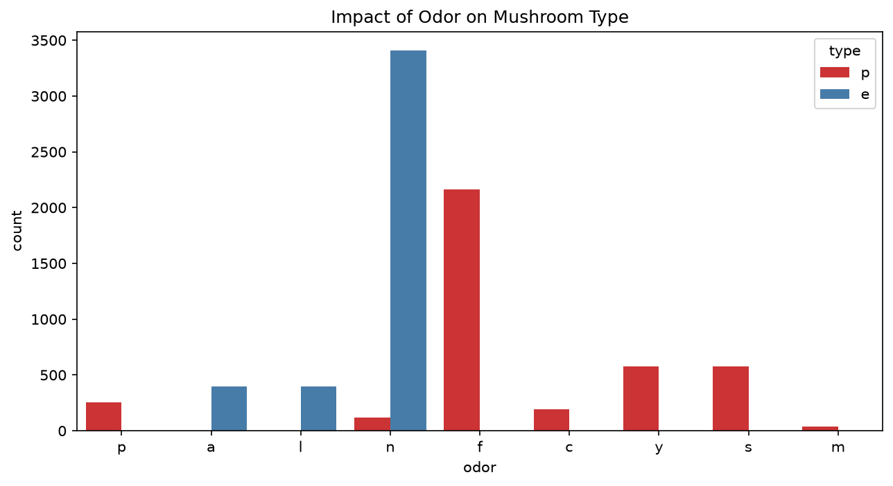

# 🍄 Mushroom Classification: Data Analysis & ML Project

## 📌 Project Overview
Is project mein humne Mushroom dataset ka analysis kiya hai taake pata chal sake ke kaun se mushroom khane layak hain (Edible) aur kaun se zehrilay (Poisonous).

## 📊 Data Analysis (EDA) Insights
- **Total Data:** 8124 rows aur 23 columns.
- **Missing Values:** 0 (Data bilkul clean hai).
- **Key Insight:** Jis mushroom ki smell 'foul' ya 'fishy' hai, wo 100% poisonous hota hai!

## 🤖 Machine Learning Models
Maine 3 models try kiye aur unki accuracy compare ki:
1. **Decision Tree:** 96.94% Accuracy (Tuned)
2. **Random Forest:** 93.15% Accuracy
3. **XGBoost:** 100% Accuracy 🏆

## 📈 Visualizations

## 📄 Project Report
Aap yahan click karke [Mushroom Project Report](Mushroom_Project_Report.pdf) download kar sakte hain.

## 🛠️ Tech Stack
- Python, Pandas, Scikit-learn, XGBoost, Matplotlib, Seaborn.